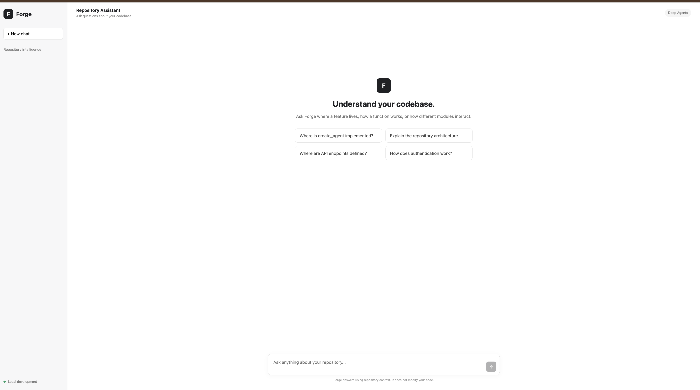
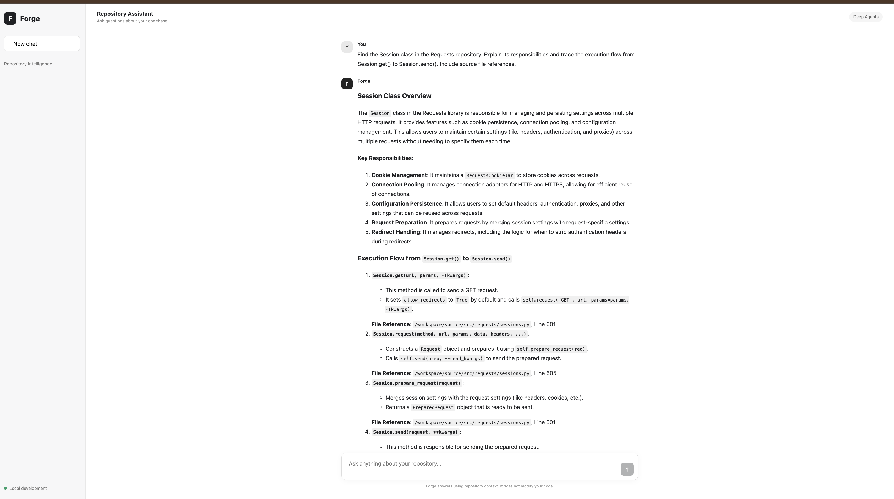

# Forge — AI-Powered Code Documentation Assistant

Forge is an AI-powered code documentation assistant that helps developers understand unfamiliar codebases through natural-language conversations.

It analyses source code, identifies symbols and relationships, explores execution flows, and answers questions with relevant source references.

## Features

- **Repository analysis:** Analyse a locally cloned GitHub repository.
- **AST-based indexing:** Extract functions, classes, methods, signatures, and source information.
- **Code search:** Search for relevant symbols and code structures using natural-language queries.
- **Call graph analysis:** Explore relationships and function call paths.
- **Conversational AI:** Ask questions about architecture, implementation, dependencies, and execution flows.
- **Streaming responses:** Receive responses incrementally through Server-Sent Events (SSE).
- **Read-only repository access:** The agent is designed to inspect source code without modifying the analysed repository.

## Technology Stack

| Component | Technology |
|---|---|
| Backend | Python, Django, Django REST Framework |
| AI Agent | Deep Agents, LangGraph |
| LLM | OpenAI GPT-4o-mini |
| Frontend | React, Vite |
| Code Analysis | Python AST |
| Communication | REST API, Server-Sent Events |
| Dependency Management | uv, npm |

---

# Getting Started

Follow these steps to run Forge locally from a fresh clone.

## 1. Prerequisites

Make sure the following tools are installed:

- Python 3.13+
- [uv](https://docs.astral.sh/uv/)
- Node.js and npm
- Git
- OpenAI API key

## 2. Clone the Forge application repository

Clone the Forge project from GitHub:

```bash
git clone <FORGE_GITHUB_REPOSITORY_URL>
cd conversational-ai
```

Replace `<FORGE_GITHUB_REPOSITORY_URL>` with the actual GitHub URL of the Forge application repository.

## 3. Configure environment variables

Create a `.env` file in the project root:

```env
OPENAI_API_KEY=your_openai_api_key
```

Replace the placeholder with your OpenAI API key.

Do not commit your `.env` file to Git.

## 4. Install backend dependencies

From the project root:

```bash
uv sync
```

This installs the Python dependencies defined in the project configuration.

## 5. Clone the repository that Forge will analyse

Forge needs a target repository to inspect.

For this example, we will use the Requests Python library:

```bash
mkdir -p forge-agent-code

git clone https://github.com/psf/requests.git \
    forge-agent-code/source
```

The directory structure should look like:

```text
conversational-ai/
│
├── forge-agent-code/
│   └── source/
│       └── requests repository files
│
├── src/
│   └── forge_agent/
│
├── agent_api/
├── config/
├── scripts/
├── frontend/
├── manage.py
├── pyproject.toml
└── README.md
```

**Important:** The Forge application repository and the target repository are separate. The target repository is the codebase that the AI assistant will analyse.

## 6. Generate the code index

Run the indexing script from the Forge project root:

```bash
uv run python scripts/index_code.py \
    --repo-root ./forge-agent-code/source \
    --output-dir ./forge-agent-code/.code_index
```

This extracts code symbols and their associated source information.

## 7. Build the call graph

After indexing, generate the function call graph:

```bash
uv run python scripts/build_call_graph.py \
    --index-dir ./forge-agent-code/.code_index
```

The generated index contains:

- `symbols.json` — extracted code symbols and source information.
- `call_graph.json` — function call relationships.

The generated files are used by the AI agent during repository exploration.

## 8. Run database migrations

From the project root:

```bash
uv run python manage.py migrate
```

## 9. Start the Django backend

Start the backend development server:

```bash
uv run python manage.py runserver 8000
```

Backend URL:

```text
http://localhost:8000
```

The streaming chat endpoint is:

```text
POST http://localhost:8000/api/chat/stream/
```

## 10. Install frontend dependencies

Open a new terminal, navigate to the frontend directory:

```bash
cd conversational-ai/frontend
```

Install the Node.js dependencies:

```bash
npm install
```

If you are already in the project root, simply run:

```bash
cd frontend
npm install
```

## 11. Start the React frontend

Run the Vite development server:

```bash
npm run dev
```

Frontend URL:

```text
http://localhost:5173
```

Open the URL in your browser to start using Forge.

---

# Application Workflow

```text
                 Developer
                     |
                     v
              React Frontend
                     |
                     | POST /api/chat/stream/
                     v
              Django Backend
                     |
                     v
             Deep Agent / LangGraph
                     |
           +---------+---------+
           |                   |
           v                   v
       search_code          Repository
           |                Filesystem
           v                   |
       Code Index               |
           |                   |
           +---------+---------+
                     |
                     v
              LLM Processing
                     |
                     v
              SSE Streaming
                     |
                     v
              React Frontend
                     |
                     v
               AI Response
```

## Example Questions

Once Forge is running, try asking:

1. Explain the overall architecture of this repository.
2. How does the `Session` class work?
3. Explain the execution flow of the `request()` method.
4. Which methods are called internally by `Session.request()`?
5. How does the library handle HTTP connections?
6. Explain the relationship between the session and adapter classes.
7. Where is the request execution logic implemented?

---

# Development and Validation

## Backend validation

```bash
uv run python manage.py check
```

## Frontend production build

```bash
cd frontend
npm run build
```

## Rebuild the repository index

If the target repository changes, regenerate the index:

```bash
uv run python scripts/index_code.py \
    --repo-root ./forge-agent-code/source \
    --output-dir ./forge-agent-code/.code_index

uv run python scripts/build_call_graph.py \
    --index-dir ./forge-agent-code/.code_index
```

---

# Current Scope and Limitations

- The current setup uses a locally cloned and indexed target repository.
- The target repository must be indexed before the agent can use its code-search capabilities.
- Arbitrary GitHub URL cloning and indexing through the UI should not be assumed to be implemented.
- Code analysis depends on the extracted symbols and call graph; dynamic runtime relationships may not be captured by static AST analysis.
- Source references should be verified against the actual repository files.
- Production deployment concerns such as multi-tenant isolation, authentication, and distributed indexing require additional implementation and validation.

## Security Considerations

- Repository inspection is intended to be read-only.
- Downloaded repository code should not be executed.
- Keep API keys and other secrets in environment variables.
- Do not commit `.env`, local databases, virtual environments, or generated secrets to version control.

---

# Project Goal

Forge aims to reduce the time developers spend understanding unfamiliar codebases by combining static code analysis, structured code indexing, call graph exploration, and conversational AI.

It provides an interactive way to investigate software architecture and implementation details without manually navigating an entire repository.

## Screenshots

### 1. Before — Initial frontend state



### 2. After — AI-generated response

